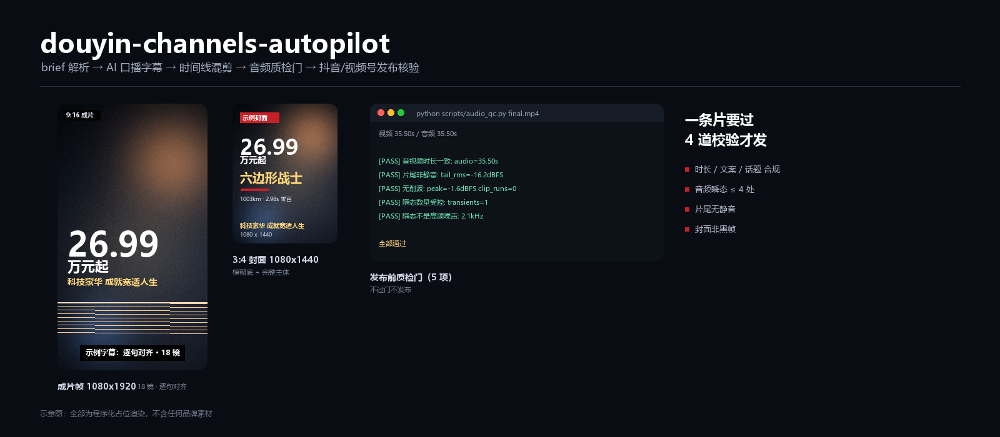

# 抖音 / 微信视频号 · 竖版短视频自动化

**Douyin & WeChat Channels vertical-video autopilot** — turn a script into a publish-ready 1080×1920 video, then publish it, without hand-editing a timeline.

一条把「口播稿 → 竖版成片 → 发布」串起来的流水线。不是灵感工具，是生产线：
输入分镜表（每段一句口播 + 一张素材），输出可直接发布的成片，并能自动发到抖音与视频号。



<sub>示意图为程序化占位渲染（背景是生成的电影感底图），不含任何品牌素材。</sub>

---

## 它和普通剪辑不一样的地方

普通剪辑是「先排画面再配音」，改一句稿就要重排整条时间轴。

这条流水线反过来：**每个分镜先写口播 → 单独配音 → 用音频时长反推画面时长**。

```
分镜表(JSON) → 分段 TTS(逐词时间戳) → 段长 = 音频 + 气口
                 ├─ 图片：满屏 Ken Burns
                 ├─ 16:9 视频：前景 + 同帧模糊背景（自动变速匹配旁白）
                 └─ 截图：预渲染圆角悬浮卡
                          ↓
              拼接 → 上下压暗 → 烧 ASS 双层字幕 → 混 BGM → loudnorm -14 LUFS
```

改一句稿，只影响那一段。口播、画面、字幕天然同步。

## 能力

| | 抖音 | 微信视频号 |
|---|---|---|
| 扫码登录 / 登录态检查 | ✅ | ✅ |
| 立即发布 | ✅ | ✅ |
| 定时发布 | ✅ | ❌ **[已知不可用](docs/04-gotchas.md)**，只立即发 |
| 3:4 竖版封面 | ✅ | ✅ |
| 短标题（7~15 字） | — | ✅ |
| 平台硬约束前置校验 | ✅ 标题≤30 字等 | ✅ 短标题 7~15 字等 |

发布层封装 [social-auto-upload](https://github.com/dreammis/social-auto-upload)（MIT），本仓库**不内置**它。

## 快速开始

```bash
git clone https://github.com/Wangmarco123/douyin-channels-autopilot.git
cd douyin-channels-autopilot
python -m venv .venv && .venv\Scripts\activate      # macOS/Linux: source .venv/bin/activate
pip install -r requirements.txt
cp config.example.json config.json                   # 改 ffmpeg / 字体路径

python -m autopilot doctor        # 环境自检
python examples/run_example.py    # 不用任何素材，现场生成一条 15 秒演示片
```

看到 `out/demo.mp4` 就说明整条链通了。

出正式片：

```bash
python -m autopilot build  examples/storyboard.example.json
python -m autopilot cover  examples/cover.example.json
```

发布：

```bash
python -m autopilot login   douyin  --account main
python -m autopilot publish douyin \
  --file out/作品A.mp4 \
  --title "开头一句话，决定前3秒留不留人" \
  --desc  "补充事实与结论，完整信息放这里，别塞进标题。" \
  --tags  "话题一,话题二" \
  --thumbnail out/封面A.jpg
```

## 发布前质检门（`qc`）

成片出来后，**先过门再发布**：

```bash
python -m autopilot qc out/final.mp4 --expect-duration 35.5
```

5 项判定，任一不过退出码 1：

| 检查 | 阈值 | 拦的是什么 |
|---|---|---|
| 音视频时长一致 | ±0.30s | `amix duration=first` 造成的片尾静音 |
| 片尾非静音 | RMS > -60 dBFS | 黑屏/静音片尾被判低质 |
| 无削波 | 峰值 ≤ -1.0 dBFS | 爆音 |
| 周期性瞬态 | ≤ 4 处 | 每个切点塞一条音效的典型症状 |
| 瞬态频谱重心 | < 6 kHz | 高频噪声型 whoosh（"噗呲"元凶） |

为什么要有这道门：两次真实返工都不是画面问题——一次是每个切点加了自合成噪声 whoosh
（频谱重心 8.3kHz，17 个切点叠成"噗呲噗呲"），一次是混音写成 `amix duration=first`
导致 35.5 秒的片子最后 2 秒没声音。**肉眼看不出来，只能靠测量。**
详见 [06-audio-rules.md](docs/06-audio-rules.md)。

## 目录

```
autopilot/
  config.py    配置加载 + 环境自检
  engine.py    成片装配（配音对齐 / KenBurns / 模糊填充 / ASS 字幕 / BGM 响度）
  cards.py     卡片与封面（截图悬浮卡 / 数据卡 / 片尾卡 / 3:4 封面）
  qc.py        发布前音频质检门（5 项测量，不过不发）
  publish.py   发布封装 + 平台硬约束校验
  cli.py       命令行入口
docs/
  01-install.md      环境与安装
  02-production.md   分镜表字段、音色、素材预处理、调参
  03-publish.md      两平台发布参数与自检
  04-gotchas.md      ⭐ 20 个踩过的坑（现象→原因→解法）
  05-compliance.md   ⭐ 合规红线与上线前自检表
  06-audio-rules.md  ⭐ 音频铁律（"噗呲"事故复盘 + 混音配方）
  07-brief-checklist.md ⭐ 共创 brief 核查表（平台/时长/话题/回传）
examples/            最小可跑示例（自动生成素材）
assets/              素材占位目录（img / vid / bgm，不提交内容）
SKILL.md             Agent skill 入口（可直接放进 Claude Code / Codex / DSH 的 skills）
```

## 最值钱的几页文档

- **[04-gotchas.md](docs/04-gotchas.md)** — 20 条真机踩坑：视频号定时为什么会卡死、抖音定时怎么改成立即发而不用重传、混音为什么莫名小 6dB、中文字幕为什么变方块、素材里的黑场怎么定位、字幕为什么闪 0.4 秒、PNG 静帧为什么让 ffmpeg 卡死……
- **[05-compliance.md](docs/05-compliance.md)** — 事实校验、绝对化用语、隐私打码、AI 声明、平台条款，以及一张 30 秒上线自检表。
- **[06-audio-rules.md](docs/06-audio-rules.md)** — 音频铁律：两次返工的实测数据（whoosh 频谱重心 8.3kHz、`amix duration=first` 造成片尾静音）与正确混音配方。
- **[07-brief-checklist.md](docs/07-brief-checklist.md)** — 共创 brief 核查表：平台/窗口/时长/话题/植入话术/封面/回传，逐条勾。

## 输出规格

1080×1920 / 30fps / H.264 crf20 / AAC 192k 44.1kHz / 响度 **-14 LUFS** / `+faststart`
三平台原生适配，无需转码。

## 依赖

| 组件 | 用途 | 授权 |
|---|---|---|
| FFmpeg（需 libass） | 剪辑 / 烧字幕 / 混音 | LGPL/GPL |
| [edge-tts](https://github.com/rany2/edge-tts) | 免费 TTS（无需 API Key） | LGPL-3.0 |
| [Pillow](https://python-pillow.org) | 卡片与封面渲染 | MIT-CMU |
| [social-auto-upload](https://github.com/dreammis/social-auto-upload) | 发布引擎（可选） | MIT |

## 边界与合规

- 只驱动**你自己登录的账号**；不做批量注册、指纹伪装、验证码绕过、刷量。
- 出现人工验证（扫码/实名/验证码）时由账号本人完成。
- AI 配音 / 字幕 / 生图请保留平台的「内容由AI生成」声明。
- 自动化发布请自行确认目标平台的服务条款。

## License

MIT。第三方组件各自保留其授权，见 [LICENSE](LICENSE)。
